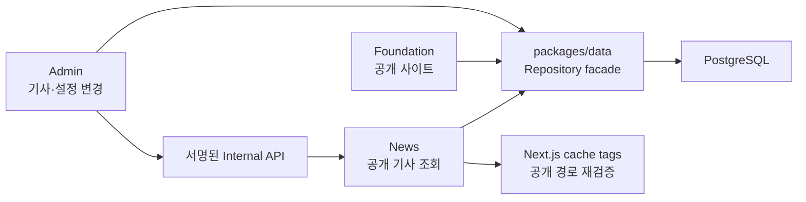
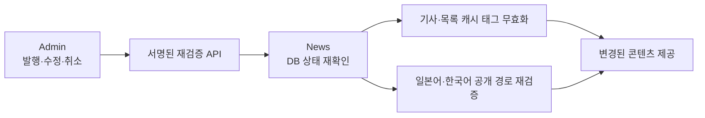

# Asnaro · 다국어 뉴스·CMS

TypeScript · Next.js · PostgreSQL · Drizzle ORM · Vercel · GitHub Actions · Turborepo

## 시스템 구조

- News와 Foundation은 공개 화면, Admin은 비공개 운영 화면입니다.
- 애플리케이션은 모놀리식 모노레포이며, 서비스별 MSA로 분리된 구조가 아닙니다.

## 기사 변경 → 공개 캐시 재검증 흐름

## 아키텍처와 데이터 경계

| 계층 | 역할 |
|---|---|
| Admin | 기사 상태 변경, 예약 발행, 감사 기록 |
| Data / PostgreSQL | 발행 상태·시각·언어 조건과 분석 집계 저장 |
| News | 공개 가능한 기사만 조회하고 공개 캐시 관리 |
| Internal API | 서명 검증 후 DB 상태를 재확인하고 캐시 무효화 |
