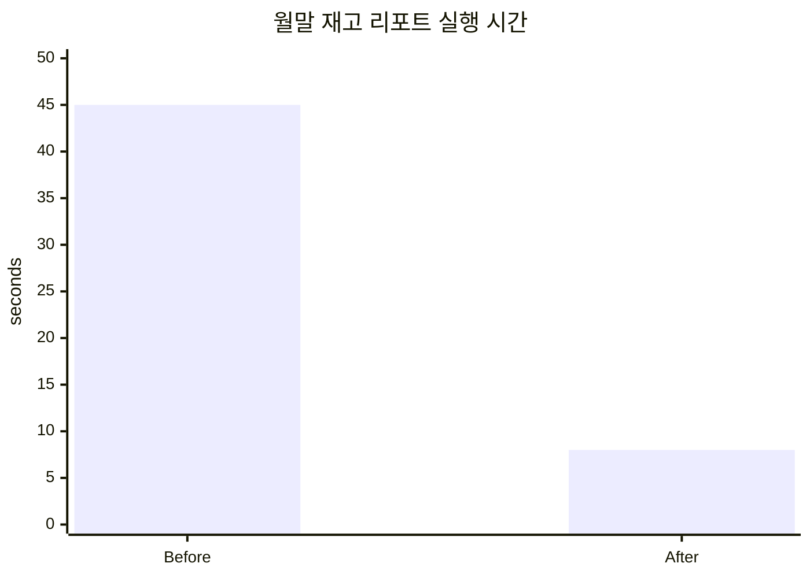

# 복산나이스 ERP · 월말 재고 리포트 쿼리 개선

C# · Oracle Database

| | Before | After |
|---|---|---|
| 실행 시간 | 45초 | 8초 (82% 단축) |
| 쿼리 구조 | 풀 테이블 스캔·반복 서브쿼리·중복 조인 | 복합 인덱스·CTE 기반 반복 집계 통합 |
| 검증 | 느린 실행 시간만 확인 | 실행 계획과 기존·개선 결과 정합성 대조 |

사내 ERP 소스 코드와 실제 데이터는 회사 자산이므로 공개하지 않습니다.
