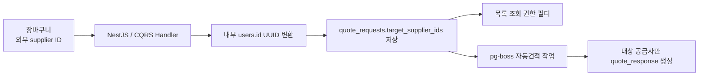
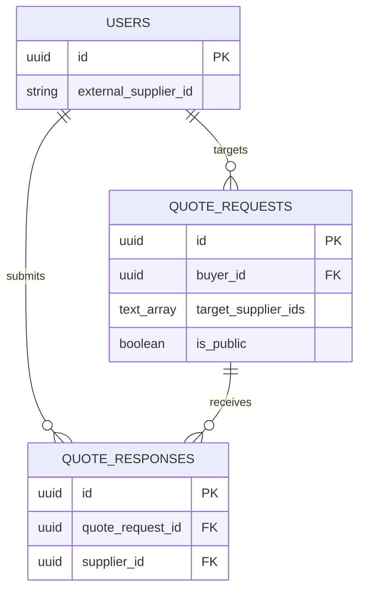

# SEMO · B2B 조달 플랫폼

NestJS · TypeScript · CQRS · Supabase/PostgreSQL · pg-boss · React · OpenAI API

## 견적 대상 공급사 식별 흐름

## 핵심 ERD

## 관련 API

| Method | Endpoint | 역할 |
|---|---|---|
| POST | `/quote-requests` | 견적 생성과 대상 공급사 UUID 저장 |
| GET | `/quote-requests/public` | 공개 또는 대상 공급사 견적 조회 |
| POST | `/quote-requests/check-auto-quote` | 자동견적 가능 여부 확인 |
| GET | `/quote-requests/:id` | 견적 상세와 접근 권한 확인 |
