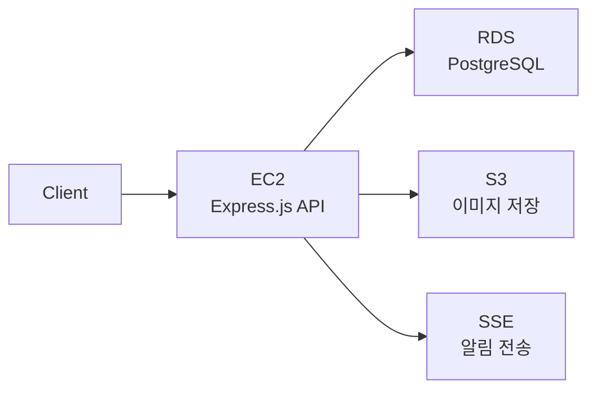
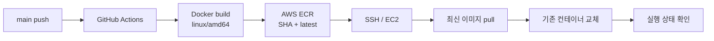
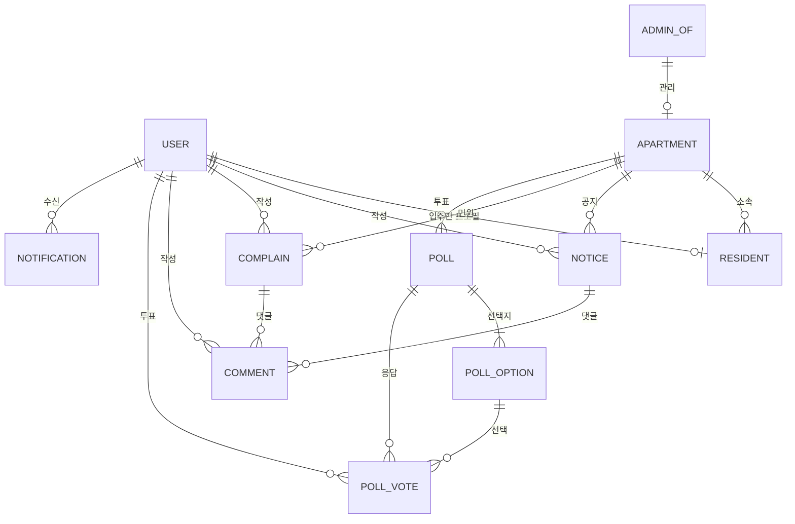

# WeLive · 아파트 관리 플랫폼

Express.js · TypeScript · Prisma · PostgreSQL · Docker · GitHub Actions · AWS EC2/ECR/RDS/S3

- 저장소: https://github.com/DoHyunGil/nb04-welive-team04

## 서비스 아키텍처

## 자동 배포(CD) 흐름

## 핵심 ERD

- `PollVote(userId, pollId)` 복합 unique 제약으로 사용자별 중복 투표를 DB에서 차단합니다.
- 댓글은 공지와 민원을 함께 다루기 위해 `resourceType`과 선택적 FK를 사용했습니다.

## API 구조

| Method | Endpoint | 인증 | 역할 |
|---|---|---|---|
| POST | `/api/v2/auth/login` | Public | 자격 증명 검증 후 Access·Refresh Token을 HttpOnly 쿠키로 설정 |
| POST | `/api/v2/auth/refresh` | Refresh Token | Refresh Token 검증 후 두 토큰 재발급 |
| POST | `/api/v2/auth/logout` | Public | 인증 쿠키 삭제 |
| GET | `/api/v2/notifications/sse` | Access Token | 인증 사용자별 SSE 알림 연결 |
| POST·GET·PATCH·DELETE | `/api/v2/notices` · `/complaints` · `/comments` · `/polls` | Access Token + 역할·소유권 검사 | 아파트 공지·민원·댓글·투표 도메인 API |

## 테스트 전략

| 구분 | 대상 | 검증 방식 |
|---|---|---|
| Unit | Service·Controller | Repository와 Express 응답 객체를 mock해 정상·예외 분기 검증 |
| Route | 인증·사용자·관리자 | Supertest로 HTTP 상태와 미들웨어 경계 검증 |
| E2E | 인증·공지·민원·댓글·투표 | 테스트 PostgreSQL을 초기화한 뒤 실제 라우트와 데이터 변경 검증 |

- 테스트 실행 전 전용 PostgreSQL 스키마를 reset·migrate하도록 분리했습니다.
